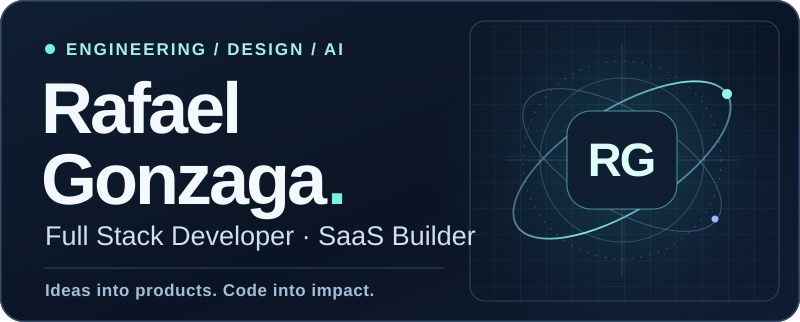
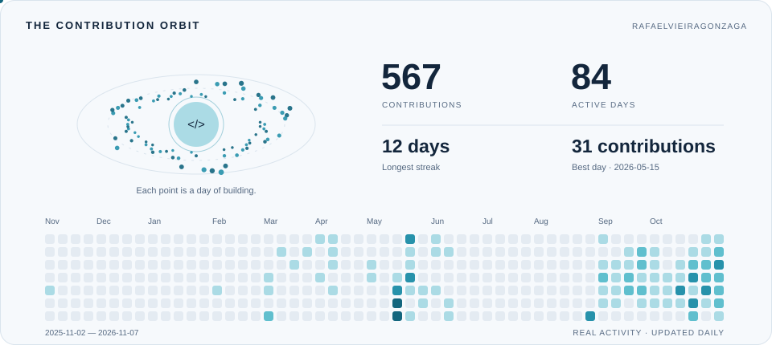

  

  
  

<h3 align="center">Thoughtful interfaces. Intelligent systems. Real-world impact.</h3>

I build digital products, SaaS platforms, and intelligent automations. 
My work connects software engineering, product design, and AI 
to turn real business challenges into useful experiences.

---

### 01 / What I build

| Product engineering | AI & automation | Full stack delivery |
| :--- | :--- | :--- |
| SaaS platforms and digital experiences designed around real business needs. | LLM integrations, connected APIs, and workflows that reduce repetitive work. | From responsive interfaces to backend services, data, and integrations. |

### 02 / My toolkit

  
  
  
  
   
  
  
  
  
   
  
  
  

### 03 / Selected work

<table>
  <tr>
    <td width="50%" valign="top">
      <h3>↗ LeadScan.ia</h3>
      
Intelligent lead prospecting and qualification in a SaaS platform.

      
SAAS · AI · BUSINESS AUTOMATION

      <a href="https://gzg-web-blond.vercel.app/">Visit my portfolio →</a>
    </td>
    <td width="50%" valign="top">
      <h3>↗ AutoFlow</h3>
      
AI-powered customer service automation and connected workflows.

      
AI · CUSTOMER EXPERIENCE · AUTOMATION

      <a href="https://github.com/RafaelVieiraGonzaga/AutoFlow">Explore project →</a>
    </td>
  </tr>
  <tr>
    <td width="50%" valign="top">
      <h3>↗ Rômulo Moissanite</h3>
      
E-commerce for precious stones, with catalog management and commercial integrations.

      
E-COMMERCE · INTEGRATIONS · PRIVATE SOURCE

      <a href="https://gzg-web-blond.vercel.app/">Visit my portfolio →</a>
    </td>
    <td width="50%" valign="top">
      <h3>↗ Personal portfolio</h3>
      
A closer look at my work, digital products, and development journey.

      
DESIGN · DEVELOPMENT · SELECTED WORK

      <a href="https://gzg-web-blond.vercel.app/">Visit portfolio →</a>
    </td>
  </tr>
</table>

### 04 / Every contribution leaves a trace

<picture>
  <source media="(prefers-color-scheme: dark)" srcset="https://raw.githubusercontent.com/RafaelVieiraGonzaga/RafaelVieiraGonzaga/output/contribution-orbit-dark.svg" />
  <source media="(prefers-color-scheme: light)" srcset="https://raw.githubusercontent.com/RafaelVieiraGonzaga/RafaelVieiraGonzaga/output/contribution-orbit.svg" />
  
</picture>

A year of building, one contribution at a time. Updated daily.

---

  <strong>Let's turn the next idea into something useful.</strong> 
  <a href="https://gzg-web-blond.vercel.app/">Explore my work</a> · <a href="https://github.com/RafaelVieiraGonzaga?tab=repositories">Explore my repositories</a>

